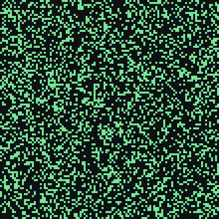
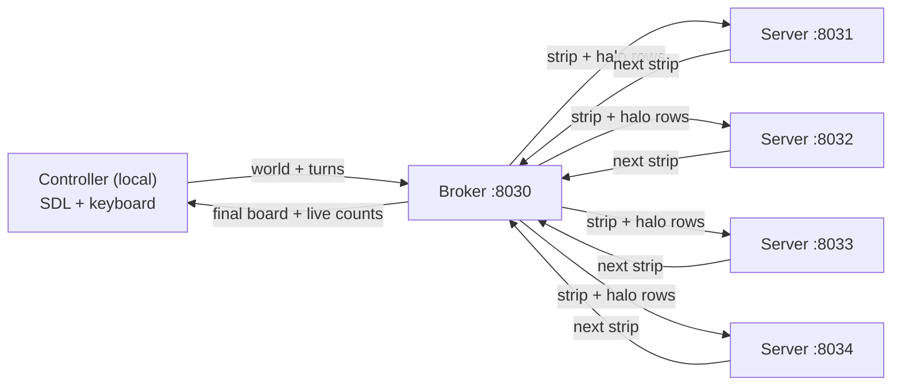

# Conway's Game of Life (Go)

One simulation, built two ways. First parallelised across worker goroutines over shared memory, then scaled out across a network of worker servers over RPC. Both run the same Game of Life on a toroidal grid, with a live SDL visualisation, keyboard control, and PGM image input and output.



The board wraps around at every edge, so a glider leaving one side reappears on the other. A starting board is loaded from a PGM image, evolved for a chosen number of turns, and can be watched live, paused, and snapshotted while it runs.

## Two implementations

### `parallel/` — shared memory

Each generation, the board is split into horizontal strips, one per worker thread. Every strip runs in its own goroutine, reading the shared current board and writing its rows into the shared next board. A `sync.WaitGroup` waits for all workers before the generation is swapped in, and a mutex guards the merge. Reporting and keypress handling run on a separate goroutine with a 2 second ticker, so they never block the compute loop. Worker count is set with `-t` and gives near linear speedup until per turn synchronisation dominates.

The engine is in `parallel/gol/distributor.go`.

### `distributed/` — across a network

The work is split across three kinds of process, each talking over TCP with Go's `net/rpc`.



- **Controller** reads the board, connects to the broker, and asks it to run the whole simulation. It drives the window, polls for the live cell count every 2 seconds, and handles keypresses.
- **Broker** owns the authoritative board. Each generation it cuts the board into four strips and sends each one, plus one halo row above and below (wrapped toroidally), to a worker server, then trims the halos and reassembles the next board.
- **Servers** are independent worker processes. Each computes the next state for the interior of its strip, using the halo rows for vertical neighbours.

Because every link is TCP, the servers can run on separate machines by pointing the broker at their addresses instead of localhost. The code is in `distributed/broker/`, `distributed/server/`, and `distributed/gol/distributor.go`.

## Controls

| Key | Action |
|---|---|
| `p` | Pause and resume |
| `s` | Save the current board as a PGM image |
| `q` | Quit, saving a final image |
| `k` | Distributed only: kill the whole system (broker then every server) |

Live cell counts print every 2 seconds.

## Build and run

Needs Go 1.17 or newer. The live window needs SDL2 (`libsdl2-dev` on Debian or Ubuntu, `sdl2` via Homebrew), or run headless.

**Parallel:**
```bash
cd parallel
go run . -w 512 -h 512 -t 8 -turns 100            # live window
go run . -w 512 -h 512 -t 8 -turns 100 -headless  # no window
```

**Distributed** (start the workers, then the broker, then the controller):
```bash
cd distributed
go run server/server.go -port 8031
go run server/server.go -port 8032
go run server/server.go -port 8033
go run server/server.go -port 8034
go run broker/broker.go -port 8030
go run . -w 512 -h 512 -turns 100
```

Controller and parallel flags: `-w` width, `-h` height, `-t` threads (parallel), `-turns` generations, `-headless`.

## Tests

```bash
cd parallel     && go test ./...
cd distributed  && go test ./...
```

Both check the live cell count and the exact board against reference data in `check/` across several sizes and turn counts. `distributed/` also has a benchmark in `my_benchmark_test.go`.

## Layout

```
parallel/      goroutine strips over shared memory  (engine: gol/distributor.go)
distributed/   broker + four RPC worker servers     (broker/, server/, gol/distributor.go)
docs/          the animation used in this README
```

Each folder is its own Go module and builds independently.

## Notes

University of Bristol, Computer Systems A coursework, 2025. Built on the course Game of Life skeleton ([docs](https://uob-csa.github.io/gol-docs/)); the parallel engine, the broker, and the servers are my own work. The LICENSE is the course skeleton's. If you are currently taking this unit, you are welcome to read it, but please do not submit any of it as your own.
